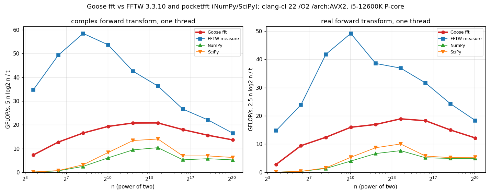

# fft

Fast Fourier transforms for [Goose](https://aardappel.github.io/goose/), in pure Goose: no C, no
build step, nothing to install. Complex and real transforms of any length, 2-D transforms, and the
usual helpers (`fftfreq`, `fftshift`, `convolve`).

```goose
import fft from "guillochon/goose-fft@v0.1.0";   // or from "../goose-fft" for a local checkout

fn main() {
    let x: f64[] = [1.0, 2.0, 1.0, -1.0, 1.5, 0.0, -2.0, 0.5];
    let spectrum = fft::rfft(x);                 // x.len / 2 + 1 bins
    let back = fft::irfft(spectrum, x.len);
    print(spectrum, "\n", back);
}
```

Goose fetches the package the first time a program uses it. Pin a tag, as here, or a commit
(`"guillochon/goose-fft@<commit>"`).

## Conventions

- A complex number is `fft::complex { re, im }`, so a `complex[]` is laid out like C99's
  `double complex[]` or NumPy's `complex128` array. Real signals are plain `f64` arrays.
- Normalization is NumPy's: the forward transform is unnormalized,
  X[k] = Σⱼ x[j] e^(−2πi jk/n), and the inverse divides by n.
- A **plan** holds a length's twiddle factors and the scratch a transform works in. The plan-less
  functions (`fft`, `rfft`, ...) build one per call, which costs more than the transform itself for
  short lengths, so reuse a plan when transforming many arrays of one length:

  ```goose
  let p = fft::plan_complex(4096);
  var out: fft::complex[>..] = [];
  out.resize(4096, fft::complex { 0.0, 0.0 });
  for frame in frames { fft::execute_into(p, frame, out, false); ... }
  ```

- Results are built straight into the caller's variable; the `_into` forms write into an array you
  pass, which may be the input itself (in place).
- Lengths that don't match the plan, and a plan of the wrong kind, abort.
- Everything is in namespace `fft`. Goose's UFCS doesn't cross namespaces, so write
  `fft::fft(x)`, not `x.fft()`.

## API

| Area | Functions |
|---|---|
| Complex | `fft(x)`, `ifft(x)`; with a plan: `plan_complex(n)`, `execute(p, x)`, `execute_inverse(p, x)`, `execute_into(p, x, y, inverse)` |
| Real | `rfft(x)` (n/2 + 1 bins), `irfft(spectrum, n)`; with a plan: `plan_real(n)`, `execute_real(p, x)`, `execute_real_inverse(p, spectrum)`, `execute_real_into(p, x, y)`, `execute_real_inverse_into(p, spectrum, y)` |
| 2-D | `fft2(x, rows, cols)`, `ifft2(x, rows, cols)`, `transform2_into(x, rows, cols, inverse)` (row-major, in place) |
| Helpers | `fftfreq(n, d)`, `rfftfreq(n, d)`, `fftshift(x)`, `ifftshift(x)` (any element type), `convolve(a, b)` (linear, real) |

## Algorithms and accuracy

- **Any length.** Lengths whose prime factors are all at most 31 are split into radix-8, 4 and 2
  passes for the power of two, then radix 3 and 5 passes and a general odd-radix pass for the
  rest. A length with a larger prime factor goes through **Bluestein's algorithm**: a chirp
  multiply, and a circular convolution of a padded 2ᵃ3ᵇ5ᶜ length done with two transforms.
- **Six steps.** A transform of n = n₁ n₂ points runs as Bailey's six-step algorithm, with the
  split as even as n allows. The n₁ columns of x, viewed as n₂ rows by n₁ columns, are
  transformed; the result is multiplied by twiddle factors and transposed; and the n₂ columns of
  that are transformed.
- **Four columns at a time.** Every step transforms four columns at once, one per lane of a `v4`,
  a struct of four `f64`s that Goose adds and multiplies elementwise. Real and imaginary parts sit
  in separate `v4`s, side by side in a `cv4`, so a butterfly is a few whole-`v4` operations,
  which the C compiler turns into AVX2 instructions as written. A length that doesn't divide into
  groups of four leaves some lanes idle rather than taking a slow path.
- **Columns in cache.** Columns go through the passes in blocks sized to stay in L1/L2 (256
  `cv4`s for lengths up to 65,536, then up to 8,192, so that long transforms read memory in long
  runs). The Stockham passes autosort, so no bit-reversal pass is needed.
- **Codelets.** Lengths up to 64 whose two factors are both 2, 3, 4, 5, 6 or 8 run each step as a
  generated straight-line codelet (`codelets.goose`, from `tools/gen_codelets.py`), with constants
  folded and trivial twiddles turned into additions; both steps inline into one kernel.
- **Real transforms** of even length n are a complex transform of n/2 points of the packed
  samples, then one O(n) pass that separates the even and odd halves. Odd lengths go through the
  complex transform.
- **Accuracy.** Twiddle factors are computed from integer-reduced angles in the first octant, so
  each is correct to a unit or two in the last place. The tests check the transforms against a
  direct DFT at every length up to 160 and many larger ones, and the round trip, to within
  4·10⁻¹⁵·(1 + log₂ n) relative to the largest value.
- `fft2` transforms the rows, then gathers each column, transforms it and scatters it back.

## Building for speed

`goose build` uses the C compiler it finds. On Windows with Visual Studio 2026 that is clang-cl,
ahead of MSVC; `GOOSE_CC` or `--cc` picks another.

- **Under clang:** the passes are `simd fn`s, so Goose builds each for baseline x86-64 and again for
  AVX2 and AVX-512, and picks the widest the CPU has at run time. A plain `goose build` is the
  fast build.
- **Under MSVC:** `simd` does nothing, so enable AVX2 yourself: `CL="/arch:AVX2" goose build
  yourprogram.goose`. With gcc or clang outside clang-cl, the equivalent is `-march=x86-64-v3`.
- **No FMA:** Goose turns floating-point contraction off in the C it generates, so results don't
  depend on the compiler. FFTW's AVX2 kernels do use fused multiply-adds, which accounts for part
  of the gap below.

## Performance

### Test setup

| | |
|---|---|
| CPU | Intel Core i5-12600K (Alder Lake): 6 performance cores, 3.7 GHz base, 4.9 GHz turbo, 48 KB L1d and 1.25 MB L2 each; 20 MB shared L3 |
| Memory | 32 GB DDR5-6200 |
| OS | Windows 11 Home 23H2 (build 22631), High performance power plan |
| Goose | v2026.3, compiled by clang-cl 22.1.3 (Visual Studio 2026) with `/O2 /arch:AVX2`. A plain `goose build` measured within 5% of that at every length. |
| FFTW | 3.3.10, built from source by the same clang-cl with `/O2 /arch:AVX2` and FFTW's AVX, AVX2 and FMA kernels (`bench/get_fftw.ps1`), out-of-place `FFTW_MEASURE` plans |
| pocketfft | NumPy 2.2.6 and SciPy 1.16.0 on Python 3.12, `scipy.fft` with `workers=1` |
| Pinning | Every run on logical CPU 4, a performance core |

Every time is the best of at least five samples and 0.2 s, each sample enough calls to take about
a millisecond. Transforms go into a preallocated output with a plan made beforehand, as FFTW is
timed; planning time isn't counted. NumPy and SciPy pay about 2.5 µs of Python call overhead per
transform, which dominates their short lengths.



GFLOP/s are FFTW's convention, 5 n log₂ n / t (half that for real transforms), whatever the length.
Times in µs, single-threaded:

| n | Goose | FFTW | NumPy | SciPy | Goose / FFTW |
|---|---|---|---|---|---|
| **complex** | | | | | |
| 64 | 0.151 | 0.039 | 3.12 | 2.67 | 3.9× |
| 1,024 | 2.65 | 0.95 | 8.43 | 6.15 | 2.8× |
| 4,096 | 11.8 | 5.77 | 26.0 | 18.4 | 2.1× |
| 65,536 | 292 | 197 | 998 | 760 | 1.5× |
| 2²⁰ | 7,685 | 6,356 | 20,053 | 16,783 | 1.2× |
| 1,000 | 2.99 | 1.14 | 8.81 | 5.96 | 2.6× |
| 100,000 | 527 | 271 | 1,529 | 1,107 | 1.9× |
| 1,000,000 | 7,654 | 6,912 | 17,338 | 13,402 | 1.1× |
| 1,009 (prime) | 16.6 | 13.2 | 42.7 | 26.3 | 1.3× |
| 10,007 (prime) | 204 | 125 | 679 | 263 | 1.6× |
| **real** | | | | | |
| 1,024 | 1.61 | 0.52 | 6.44 | 4.81 | 3.1× |
| 65,536 | 143 | 82.9 | 509 | 456 | 1.7× |
| 2²⁰ | 4,309 | 2,858 | 10,623 | 9,830 | 1.5× |
| 1,000,000 | 4,190 | 2,788 | 9,598 | 9,062 | 1.5× |

In short:
- **Against pocketfft through NumPy and SciPy**, Goose is faster at every length measured, 1.3–2.6×
  at lengths of 4,096 and up, where Python's call overhead no longer matters.
- **Against FFTW**, Goose takes 1.1–1.7× FFTW's time on long transforms (2¹⁶ points and up) and
  2–4× on short ones. FFTW's kernels use FMA, which Goose's C never does, and its codelets keep
  transforms of up to 64 points in registers. In Goose those take passes through memory, as long
  straight-line codelets compile poorly (see below).

How it got here, at n = 4,096 complex (FFTW: 5.8 µs):

| Version | µs | |
|---|---|---|
| Radix-4 Stockham on split real/imaginary arrays | 25.1 | Clang vectorized each pass's loop only when it ran 68+ times, because of the runtime checks that 16 separate slices don't overlap; most passes ran scalar. |
| Six steps, column blocks | 23.4 | Long inner loops everywhere, padded scratch to avoid 4K aliasing; still the same scalar fallback. |
| Four-lane `v4` structs | 13.3 | Each butterfly is whole-struct arithmetic, which clang vectorizes with no overlap checks at all. |
| Real and imaginary side by side (`cv4`), radix 8 | 12.6 | Half the pointers per pass, and radix 8 does 1.5× the work per load and store of radix 4. |
| Small generated codelets, one kernel for lengths up to 64 | 11.8 | The 16- to 64-point codelets compiled to code with thousands of spills and scalar operations (clang's SLP vectorizer gives up on long blocks), so only those up to 8 points are used. |

Tried and dropped: fusing step A's first pass with the load of x and step B's last pass with the
store of y (20–45% slower: the extra strided loads inside the radix-8 butterfly cost more registers
than the sweep they save), and vectorizing the real transform's last pass (within noise).

### Reproducing

In `bench/` on Windows, with Goose on `PATH` (or `$env:GOOSE` set):

```bash
powershell -File get_fftw.ps1
```
```bash
powershell -File run_bench.ps1
```
```bash
python compare.py
```

`get_fftw.ps1` downloads FFTW 3.3.10 (checking its MD5), builds it into `bench/third_party` and
builds `bench_fftw.exe` against it. `run_bench.ps1` builds and runs the Goose benchmark, FFTW
(measure and patient planning; patient planning of the long and prime lengths takes hours, and
wasn't measured above) and NumPy/SciPy, each pinned to one core; `-Core` picks another,
`-Only goose|fftw|numpy` runs one, and `-Flags` sets the C compiler flags for the Goose build.
`bench/profile.goose` times the phases of one transform and `bench/sweep.goose` sweeps the block
size, for tuning.

## Tests

```bash
goose test/test_fft.goose
```

The suite runs 641 checks and exits 1 on any failure:
- **Against a direct DFT** (twiddles reduced in integers): every length from 1 to 160, and
  powers of two, smooth lengths, prime powers and products of primes up to 4,096, both ways.
- **Bluestein lengths:** primes and products with large primes (37 to 2·997), against the DFT.
- **Large lengths**, 16,384 to 1,048,576 and 1,000,000 (including 3·2¹⁶ and the primes 10,007
  and 65,537): sampled bins against direct sums, and the round trip.
- **Exact transforms** (an impulse, a constant, a pure tone) and **identities**: linearity,
  Parseval's theorem, the shift theorem.
- **Plans** reused and transforms in place, forward and inverse.
- **Real transforms** against the complex one at every length from 1 to 69 and at larger even,
  odd and Bluestein lengths, and their round trips.
- **2-D** transforms against a direct double sum, including 1×n, n×1 and odd shapes.
- **Helpers** against hand-worked values, and `convolve` against the direct sum.

The suite passes in-process and as native builds with clang-cl 22 and MSVC 19.51, plain and with
`/arch:AVX2`.

`examples/spectrum.goose` finds the tones in a noisy signal, smooths it by convolution, and
multiplies two numbers through their digits' spectra.

## License

Apache-2.0, the same license as Goose itself (see `LICENSE`).
